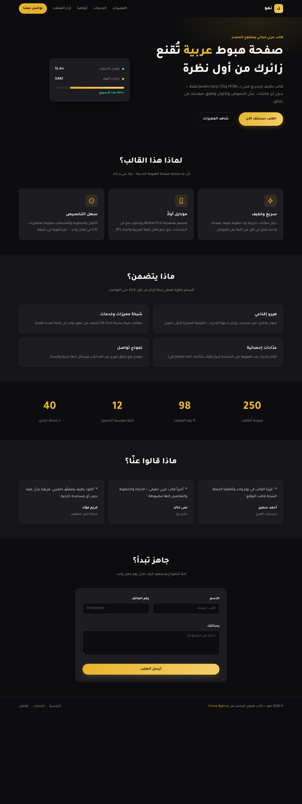

# قالب صفحة هبوط عربية (RTL Landing Template)

قالب صفحة هبوط عربية كامل، مبني بـ **HTML وCSS وJavaScript فقط** — بدون أي مكتبات أو أدوات بناء. من تطوير [Sonoa Agency](https://sonoa.online).



## المميزات

- **عربي أولاً**: اتجاه RTL كامل، خط Tajawal، وتعليقات الكود بالعربية.
- **خفيف وسريع**: صفر اعتماديات — يفتح في أقل من ثانية.
- **موبايل أولاً (Mobile-First)**: يتجاوب مع كل المقاسات.
- **هوية بمتغيرات CSS**: غيّر الألوان والخط من `:root` في أول `css/style.css`.
- **تفاعلات جاهزة**: قائمة موبايل، عدّادات متحركة، ظهور عند التمرير، وتحقق من النموذج برسائل عربية.
- **إتاحة وصول**: `aria` للقائمة والنموذج، واحترام `prefers-reduced-motion`.

## التشغيل

لا يحتاج أي تثبيت — افتح `index.html` في المتصفح مباشرة، أو شغّل خادماً محلياً:

```bash
# أي من الأمرين
npx serve .
python3 -m http.server 8000
```

## التخصيص

| ماذا تريد أن تغيّر؟ | أين؟ |
| --- | --- |
| الألوان والخط والمسافات | متغيرات `:root` في `css/style.css` |
| النصوص والأقسام | `index.html` (كل قسم معلّق) |
| ربط نموذج التواصل بخدمة إرسال | التعليق داخل `js/main.js` (الجزء 5) |

## هيكل المشروع

```
├── index.html      # الصفحة الوحيدة (كل الأقسام)
├── css/style.css   # الهوية + التخطيط + التجاوب
├── js/main.js      # القائمة، العدّادات، الظهور، النموذج
└── assets/         # الصور ولقطات الشاشة
```

## الرخصة

MIT — استخدمه بحرية في مشاريعك التجارية والشخصية.

---

# Arabic RTL Landing Template

A complete Arabic landing page built with **plain HTML/CSS/JS** — zero dependencies, zero build step. By [Sonoa Agency](https://sonoa.online).

- RTL-first layout with the Tajawal font and Arabic code comments
- Mobile-first responsive design, brand driven by CSS custom properties
- Interactions included: mobile nav, animated counters, scroll reveal, Arabic form validation
- Runs by simply opening `index.html`

See the Arabic section above for usage and customization. Licensed under MIT.
